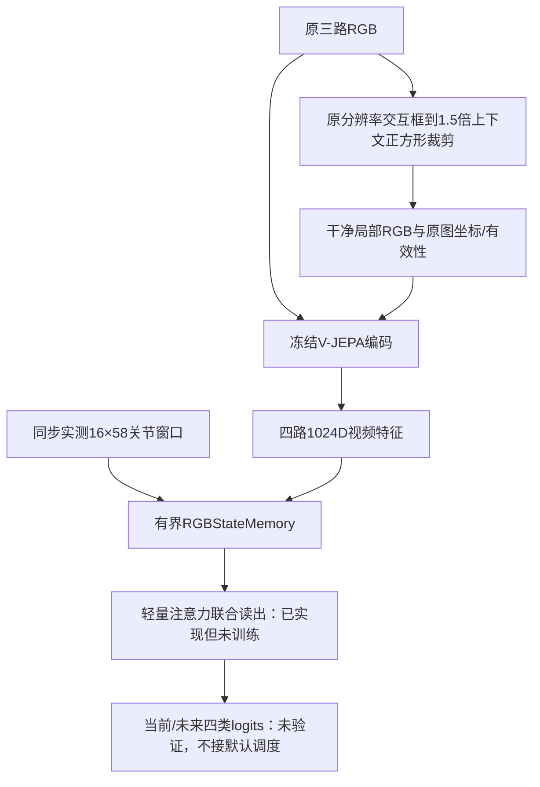

# RGB局部交互视觉与实测state Memory v2

2026-11-11（北京时间）。本轮只修改`vjepa2_training`，起点`f2f2301`，分支`research-tomato-agent`。新增独立实验模块，不替换B0、既有TaskMemory/OperationMemory或默认推理。原`memory_cooperation_v1`保留。没有修改OpenPI训练端或部署端，没有训练模型、连接机器人或修改Subtask/结果审核标签。

## 本轮落实的输入与数据流



ROI生成器本轮没有实现。已有黄色框定义交互内容，蓝绿色框对应外扩后的实际裁剪范围。`crop_rgb`接受原生RGB与交互框，默认输出Agent所需256×256；没有把224预览图放大冒充原生细节。正方形边界处理遵循既有OpenPI预览：移动/缩小且包含交互区域，无法在图内容纳时补黑。无效ROI明确记录为false，并使用当前新鲜全图的方形补黑回退，不重复旧crop。

`encode_four_views`通过现有冻结`encode_clips`实际编码四路视频，输出`[B,4,1024]`。旧三视图函数和3072D头没有修改。四路是四个池化视频向量，不是4096个token。编码器内部patch token仍取均值；保留局部空间token尚未实现。

## Memory契约

- `RGBStateWindow`携带会话、录制、观测、编码器及ROI版本身份；记录实际选帧时间、state时间、相机与原图尺寸。
- 每份观测包含`[3,1024]`全局、`[1024]`局部视频特征，以及完整`[16,58]`实测位置；不再只取窗口末帧。不接预测action或命令作为实测状态。
- 所有帧有原图裁剪坐标、ROI有效性和框首次可用时间。在线模式拒绝人工离线框及晚于对应帧的框。离线诊断模式显式保留manual_offline身份，不能宣称在线ROI收益。
- 第一版只接受完整16帧、10Hz、跨度1.5秒的窗口；启动不足1.5秒时须等待完整窗口。没有静默重复首帧或改变采样节拍。
- state必须不晚于视觉采样时刻且相差不超过50ms；观测到达年龄不超过1秒。乱序、跨身份、非有限值和无效形状拒绝且不修改缓存。
- 近期容量默认16，最大64；读取数量可独立选择1/8/16。2Hz下16份结束时间跨度7.5秒，涉及最早原画面约9秒前。间隔超过0.75秒清空近期缓存。
- 深复制写入和读取，避免调用方改动历史。Reset必须使用新session。
- **没有阶段记录、独立结果或按阶段检索锚点进入新Memory及联合读出。** 原B0维护七阶段位置的实现保留，但本模块不调用它。
- 不输出物理成功、Prompt更新或机器人动作。

## 联合读出与训练边界

`RGBMemoryReader`把四路视觉、完整关节窗口、相对时间、ROI几何/有效性和相机身份投影至128维。最新窗口作为query读取过去与当前窗口，输出Current/Future两组四类logits。没有输入历史预测概率、真实阶段或结果标签。每次只预测最新窗口，不把完整episode一次送入注意力造成未来泄漏。

每份记录压缩为一个128维读出位置；读取1/8/16份对应1/8/16个位置，不是将全部历史原始视频token送入π₀.₅。位置标准化mean/std必须从固定训练来源拟合并随checkpoint保存；本轮没有拟合新统计、没有训练或产生可部署checkpoint。合成梯度检查只证明历史输入与输出之间存在计算路径，不证明学会采摘。

后续训练端仍需完成：

1. 基于完整100条固定84/8/8身份准备具备ROI覆盖的独立四路特征缓存；ROI来源、坐标、可用时间、编码器和规范共同纳入缓存身份，不复用旧三路身份冒充四路缓存。
2. 在训练来源拟合标准化、生成因果历史样本并保存模型/数据契约，分别比较三视图、四视图无额外历史、四视图加1/8/16记录。读出输出仍以固定未来时距1.5秒生成监督，末尾未来不可见样本掩码，不能从本Smoke直接启动正式训练。
3. OpenPI训练端需要额外图像键、预处理、mask、视觉token预算及训练；其256文本上限与视觉token分别核算。本轮未改这些位置。
4. 部署须有因果自动ROI，覆盖预测误差、无效回退并使用与训练一致的处理。人工关键帧插值不是可部署定位器。

## 验证与真实回放

新增20项测试通过，覆盖完整state与快照隔离、历史容量、过期/乱序/跨身份拒绝、人工/未来ROI在线拒绝、原分辨率裁剪、边缘补黑、新鲜全图回退、第四路进入编码，以及历史参与未训练读出的输出和梯度。全部番茄专项252项通过。

在用户截图对应的`B/1106_750_791_normal/episode_000004`真实训练录制上，逐一校验原三路视频SHA与既有预览标注身份，再解码真实视频、裁剪256局部图并调用冻结官方V-JEPA GPU编码：

|片段|窗口结束帧|实际源帧|四路特征|实测state|
|---|---|---|---|---|
|pickup|45、60|0..45、15..60，步长3|每窗口4×1024|每窗口16×58|
|首次摘取|270、285|225..270、240..285，步长3|每窗口4×1024|每窗口16×58|

共4个窗口，人工框按既有关键帧离线插值，未来标注依赖保留为manual_offline。两片段间有采样缺口，Memory按契约清空，不虚构中间历史。实测state逐值与源窗口一致。录制float32时间与30Hz名义时间先核对，回放明确采用名义帧时间，不把舍入误差解释成未来观测。

四次四路编码调用约196.5、57.3、54.1、55.2ms。样本极少且含首次开销，范围包含编码前处理/传输，不含原视频解码、裁剪、Memory读出、策略或采集；不能作为正式P95或全链路实时结论。没有测新模型准确率或证明Memory增益。

摘要：`docs/validation/tomato_rgb_memory_v2_20261111/receipt.json`。特征与完整回执保留本地`runs/tomato/rgb_memory_v2_20261111/`，不提交大缓存。

## 复现

```bash
.venv-tomato/bin/python -m pytest -q tests/test_*tomato*.py
.venv-tomato/bin/python -m tools.smoke_tomato_rgb_memory \
  --annotations /home/user/tomato-openpi/training_configs/experiments/tomato_sharpa/subtasks/records/normal93_20261110_interaction_preview_annotations.json \
  --out /new/receipt/directory
```

运行目录须为主仓库；Smoke输出目录必须不存在。本轮已完成的是实验输入、缓存和读出代码及真实接线验证，尚未完成全量ROI准备、联合读出训练或默认Agent集成。
